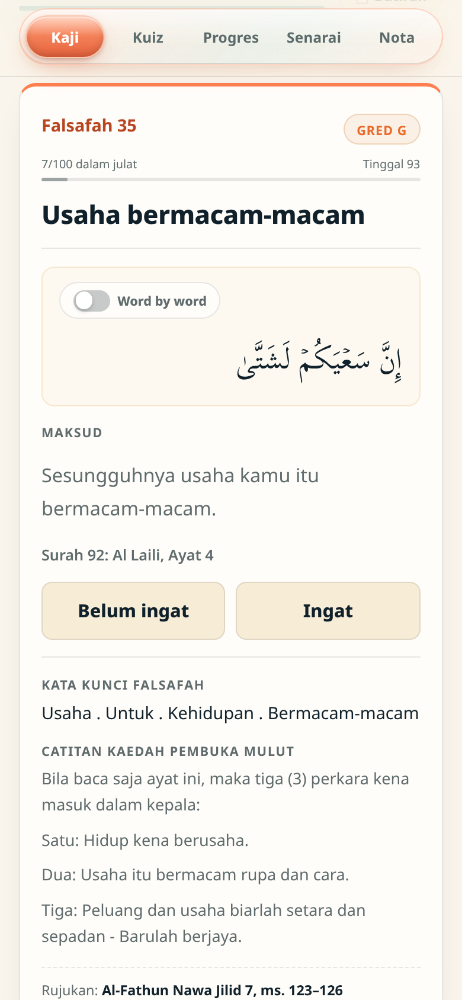
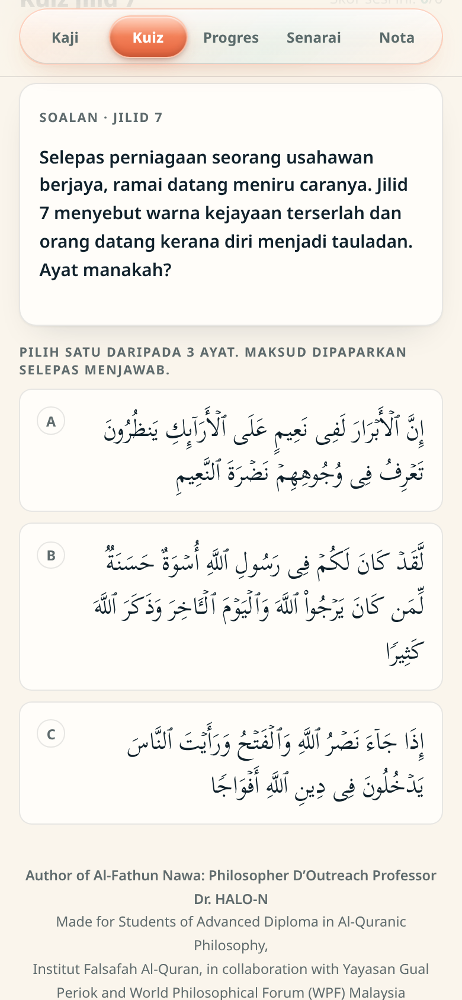
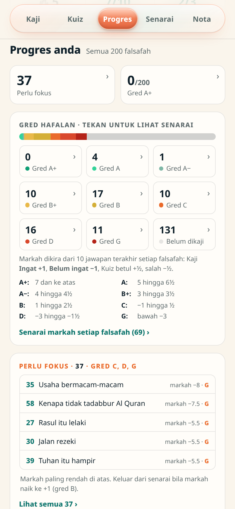
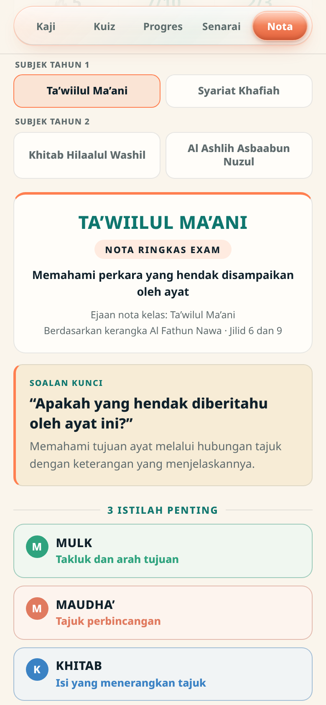

<div align="center">

# 📖 Al-Fathun Nawa: Falsafah 1-200

### Kaji. Uji. Faham. Ingat.

A study app for the 200 falsafah of _Al-Fathun Nawa Jilid 7_ by Philosopher D'Outreach
Professor Dr. HALO-N, made for students of the Advanced Diploma in Al-Quranic Philosophy.

`HTML` · `CSS` · `JavaScript` · `Python build` · `Firebase` · `Vercel` · `PWA`

**Live app: [falsafah200.vercel.app](https://falsafah200.vercel.app)**

---

**Created by Afiq Rashdi**

</div>

> [!NOTE]
> The whole app is one HTML file built from a template and JSON data. There is no framework and
> no build server. Accounts and cross-device sync come from a thin Firebase layer added at build
> time. The interface is in Bahasa Melayu.

## 📸 Showcase

<table>
<tr>
<td align="center" width="25%">

**Kaji**: recite from memory, then Dedah



</td>
<td align="center" width="25%">

**Kuiz**: Jilid 7 questions, Arabic-only answers



</td>
<td align="center" width="25%">

**Progres**: gred hafalan and Perlu fokus



</td>
<td align="center" width="25%">

**Nota**: exam notes by subject year



</td>
</tr>
</table>

Screens are the running app with a demo account and demo progress.

## 🧭 Documentation map

| I want to…                              | Go to                                                  |
| --------------------------------------- | ------------------------------------------------------ |
| See what the app does                   | [Features](#-features)                                 |
| Build and deploy                        | [Quick start](#-quick-start)                           |
| Understand how the pieces fit           | [docs/architecture.md](docs/architecture.md)           |
| Edit falsafah, quiz or note content     | [docs/data-formats.md](docs/data-formats.md)           |
| Set up Firebase rules or the admin role | [docs/security.md](docs/security.md)                   |
| Check a change before deploying         | [docs/testing.md](docs/testing.md)                     |
| Know why things are built this way      | [docs/decisions/](docs/decisions/)                     |
| Who it is for and what matters          | [PRODUCT.md](PRODUCT.md)                               |
| Colours, type and the songket motif     | [DESIGN.md](DESIGN.md)                                 |
| What changed and when                   | [CHANGELOG.md](CHANGELOG.md)                           |
| Review current limits                   | [Known boundaries](#-known-boundaries)        |

## ✨ Features

- **Kaji**: flashcards over the whole chosen julat every day. The student recites from memory,
  then presses Dedah to see the Arabic, word by word (EN and BM), maksud, Kata Kunci, Catitan and the book page.
  A day summary keeps every falsafah missed even once under Belum ingat, with "Ulang belum ingat".
- **Kuiz**: one critical-thinking question per falsafah, written from the Jilid 7 notes. Two or
  three similar-theme ayat as answers, in Arabic only. The answer reveals the ayat, maksud,
  Jilid 7 explanation and page reference.
- **Progres**: gred hafalan (A+ to G) from the last 10 answers per falsafah, the Perlu fokus list
  (gred C, D, G), a markah list, a 14-day chart and daily history. A Saturday popup lists last
  week's Belum ingat and Ingat; on Fridays the class's most-missed falsafah appear.
- **Senarai**: all 200 falsafah, searchable by number, title, maksud, surah, Kata Kunci or a
  romanised pronunciation (for example `wahuwa ma'akum`). Each falsafah can be shared as an image
  card or as text with the app link.
- **Dengar**: plays the ayat of a julat with the Quran.com murattal (Hani ar-Rifai), or Dr. HALO-N's
  own recordings for signed-in students, with word by word and lock-screen controls.
- **Pandangan**: students write how a falsafah relates to their life or to other ayat (title,
  1 to 5 linked falsafah, opinion), from the menu or a falsafah's detail sheet. The admin reads
  every one first and publishes the good ones, which other students then read with the writer's name.
- **Nota**: exam notes for the four pentafshilan methods, grouped as Subjek Tahun 1 (Ta'wiilul
  Ma'ani, Syariat Khafiah) and Subjek Tahun 2 (Khitab Hilaalul Washil, Al Ashlih Asbaabun Nuzul).
- **Daily goals**: Kaji 10 and Kuiz 3, with a streak when both are met. Counts carry on past the
  target (for example 14/10).
- **Accounts**: username and 6-digit PIN, progress merged across devices, an admin panel for the
  class, and install to the home screen as an app.

## 🚀 Quick start

You need Python 3. Nothing else is installed.

```bash
python build.py          # template.html + data.json + notes.json + quiz.json -> index.html
python build_cloud.py    # index.html + cloud/ -> cloud-test/ (the live app)
```

Open `cloud-test/index.html` through any static server to try the live version locally, or
`index.html` for the standalone version without accounts.

Deploy: push to `main`, then deploy the `cloud-test` folder to the Vercel project
`falsafah200-test` (framework none, no build or install command, output directory `cloud-test`).
The production aliases are `falsafah200.vercel.app` and the old `falsafah200-test.vercel.app`,
which now shows a moved notice.

Never edit `index.html` or `cloud-test/index.html` by hand; the next build overwrites them.

### Content pipelines

| When you change…                         | Run                                                                    |
| ---------------------------------------- | ---------------------------------------------------------------------- |
| `template.html` or `data.json`           | `build.py`, then `build_cloud.py`                                      |
| a Word document in `notes_source/`       | `build_notes.py`, then both builds                                     |
| a Kuiz question in `quiz_bank.py`        | `python quiz_bank.py` (validates and writes `quiz.json`), then builds  |
| the Arabic text for many entries         | `rebuild_tanzil.py`, `trim_tanzil.py`, `transliterate.py`, then builds |

## 🗂️ Repository map

```text
template.html         All HTML, CSS and JavaScript of the app, with JSON placeholders
data.json             The 200 falsafah (title, maksud, Arabic, Kata Kunci, Catitan, pages)
quiz_bank.py          The 200 Kuiz questions and their distractors; writes quiz.json
notes.json            Nota content, generated by build_notes.py from notes_source/
build.py              Builds index.html (standalone, no accounts)
build_cloud.py        Builds cloud-test/ (accounts, sync, install, link previews)
cloud/                Firebase layer, service worker, manifest, icons, moved notice, import
cloud-test/           Built output that Vercel serves
tanzil_quran/         Uthmani Quran text, one file per surah
rebuild_tanzil.py     Regenerates Arabic from surah and ayah ranges
trim_tanzil.py        Cuts Arabic where the book quotes part of an ayat
transliterate.py      Builds the romanised text used by pronunciation search
docs/                 Architecture, data formats, security, testing, decisions, screenshots
```

## ⚠️ Known boundaries

- Kuiz questions were written for the app from the Jilid 7 notes. Some open with an everyday
  scenario that is not in the book. They should be reviewed by an ustaz before being treated as
  official exam material.
- Word by word comes from Quran.com. The BM line is the word set Quran.com labels Indonesian; its
  wording is Bahasa Melayu. Each ayat is fetched once and then kept on the device.
- The Arabic text comes from Tanzil via quran-data and has not been formally reviewed. Please
  report any errors.
- Progress lives on the device and syncs through Firebase when signed in. The standalone
  `index.html` keeps progress only in that browser.
- Dr. HALO-N's recordings are for registered students only and are never stored in this repository.

## 🙏 Sources and credits

- Falsafah titles, maksud, Kata Kunci, Catitan and page numbers: _Al-Fathun Nawa Jilid 7_ by
  Prof. Dr. HALO-N.
- Quran text: [khaledhosny/quran-data](https://github.com/khaledhosny/quran-data), based on the
  [Tanzil](https://tanzil.net) Uthmani text.
- Word by word and murattal audio: [Quran.com](https://quran.com) API.
- Exam notes prepared by Peguam Ghazali.
- Fonts: [Scheherazade New](https://software.sil.org/scheherazade/) by SIL and Noto Sans, from
  Google Fonts.

---

<div align="center">

### 📖 Falsafah 200

Made for students of the Advanced Diploma in Al-Quranic Philosophy, Institut Falsafah Al-Quran,
in collaboration with Yayasan Gual Periok and World Philosophical Forum (WPF) Malaysia.

**Created by Afiq Rashdi**

</div>
